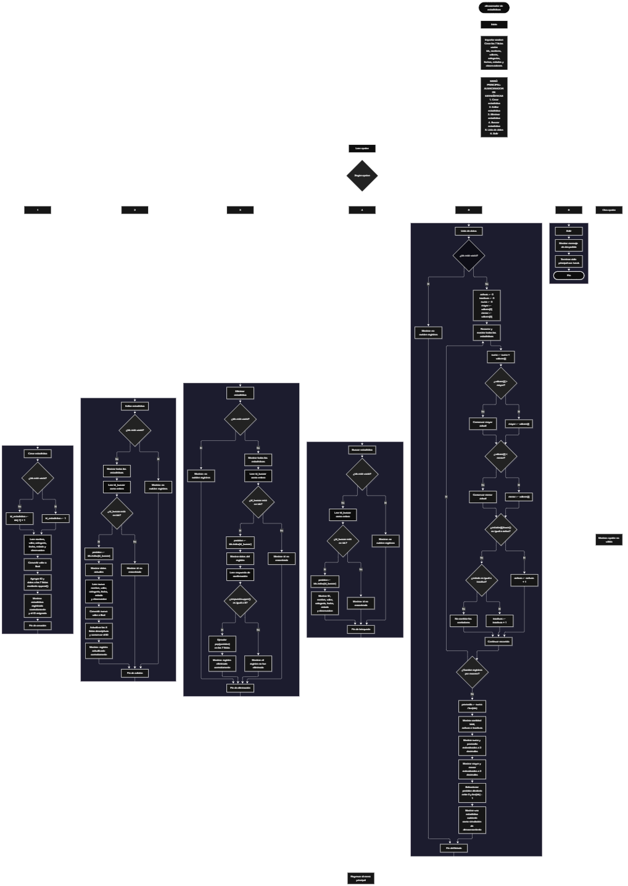

 

Este proyecto, llamado <b>almacenador de estadísticas</b>, fue desarrollado en <b>python</b> como un ejercicio práctico para fortalecer la lógica de programación mediante la creación de un sistema de gestión de estadísticas desde la consola. El programa cuenta con un menú principal de seis opciones que permite <b>crear, editar, eliminar, buscar y listar estadísticas, además de salir del sistema</b>. Cada estadística almacena datos como el nombre, el valor numérico, la categoría, la fecha de registro, el estado y una observación, utilizando siete listas paralelas para organizar la información durante la ejecución. Durante su desarrollo se aplicaron conceptos fundamentales de programación, como variables, listas, estructuras condicionales, ciclos repetitivos, conversiones de tipos de datos y operaciones para buscar, modificar, eliminar y analizar registros. Además, el programa permite calcular la suma, el promedio, el valor mayor y el valor menor, contar las estadísticas activas e inactivas y realizar una simulación mediante la selección aleatoria de un registro existente. Este proyecto permite poner en práctica los conocimientos adquiridos en Python y sirve como base para desarrollar sistemas de gestión y análisis de datos más avanzados.

<h2 align="center">⚙️ Funcionamiento del menú principal</h2>

### ➕ Crear estadística

La opción <b>1) crear estadística</b> permite registrar una nueva estadística en el sistema. Antes de realizar el registro, el programa comprueba si la lista <b>ids</b> está vacía mediante la condición <b>len(ids) == 0</b>. Si no existen registros, asigna el identificador <b>1</b> a la nueva estadística. En caso contrario, calcula el siguiente identificador utilizando el último elemento de la lista mediante la expresión <b>ids[-1] + 1</b>. Después, solicita el <b>nombre, valor numérico, categoría, fecha de registro, estado y observación</b>. El valor numérico se convierte al tipo <b>float</b> mediante la función <b>float()</b>. Una vez introducidos los datos, el programa utiliza el método <b>append()</b> para almacenar el identificador y cada uno de los campos en sus respectivas listas. Finalmente, muestra el mensaje <b>"estadística registrada correctamente."</b> y presenta el ID asignado al registro.

### ✏️ Editar estadística

La opción <b>2) editar estadística</b> permite modificar la información de una estadística registrada. Primero, el programa comprueba si existen registros mediante la condición <b>len(ids) == 0</b>. Si no hay estadísticas almacenadas, muestra el mensaje <b>"no existen registros."</b>. En caso contrario, presenta una lista con el ID, nombre, valor, categoría, fecha, estado y observación de cada registro mediante un ciclo <b>for</b>. Después, solicita el identificador de la estadística que se desea editar y convierte el valor introducido a un número entero mediante <b>int()</b>. Si el ID se encuentra en la lista <b>ids</b>, obtiene su posición mediante <b>ids.index(id_buscar)</b> y muestra los datos actuales. A continuación, solicita los nuevos valores de los seis campos descriptivos y actualiza directamente las posiciones correspondientes en las listas <b>nombres, valores, categorias, fechas, estados y observaciones</b>. El identificador original se conserva. Finalmente, muestra el mensaje <b>"registro actualizado correctamente."</b>. Si el ID no existe, presenta el mensaje <b>"id no encontrada."</b>.

### 🗑️ Eliminar estadística

La opción <b>3) eliminar estadística</b> permite eliminar una estadística registrada mediante su identificador. Primero, el programa comprueba si existen registros. Si la lista <b>ids</b> está vacía, muestra el mensaje <b>"no existen registros."</b>. Si hay estadísticas almacenadas, presenta todos los registros mediante un ciclo <b>for</b> y solicita el ID que se desea eliminar. El valor introducido se convierte a entero mediante <b>int()</b>. Si el identificador existe, el programa obtiene su posición con <b>ids.index(id_buscar)</b> y muestra los datos de la estadística seleccionada. Después, solicita confirmación mediante la pregunta <b>"¿desea eliminar este registro? (s/n):"</b>. Si la respuesta convertida a mayúsculas mediante <b>respuesta.upper()</b> es igual a <b>"S"</b>, utiliza el método <b>pop(posicion)</b> para eliminar la posición correspondiente de las siete listas: <b>ids, nombres, valores, categorias, fechas, estados y observaciones</b>. Finalmente, muestra el mensaje <b>"registro eliminado correctamente."</b>. Si la respuesta no es <b>"S"</b>, presenta el mensaje <b>"el registro no fue eliminado."</b>. Si el ID no se encuentra, muestra el mensaje <b>"id no encontrada."</b>.

### 🔎 Buscar estadística

La opción <b>4) buscar estadística</b> permite localizar una estadística mediante su identificador. Primero, el programa comprueba si existen registros almacenados. Si no hay estadísticas, muestra el mensaje <b>"no existen registros."</b>. En caso contrario, solicita el ID que se desea buscar y convierte el dato introducido a entero mediante <b>int()</b>. A continuación, utiliza la condición <b>id_buscar in ids</b> para comprobar si el identificador se encuentra en la lista. Si existe, obtiene la posición correspondiente mediante <b>ids.index(id_buscar)</b> y muestra el ID, nombre, valor, categoría, fecha, estado y observación de la estadística encontrada. Si el identificador no aparece en la lista, presenta el mensaje <b>"id no encontrada."</b>. Esta operación permite consultar un registro específico sin necesidad de recorrer manualmente toda la información mostrada en pantalla.

### 📋 Lista de datos

La opción <b>5) lista de datos</b> permite visualizar todas las estadísticas registradas y obtener un resumen de sus principales valores numéricos. Antes de comenzar, el programa comprueba si existen registros. Si la lista <b>ids</b> está vacía, muestra el mensaje <b>"no existen registros."</b>. Si hay estadísticas disponibles, inicializa las variables <b>activas</b>, <b>inactivas</b> y <b>suma</b> con el valor <b>0</b>. También establece las variables <b>mayor</b> y <b>menor</b> con el primer elemento de la lista <b>valores</b>, que sirve como referencia inicial para identificar el valor máximo y el mínimo. Después, utiliza un ciclo <b>for</b> para recorrer las estadísticas, mostrar sus datos, acumular la suma de los valores y comparar cada valor con los valores mayor y menor encontrados hasta el momento. Durante el recorrido, también comprueba el estado de cada registro mediante las condiciones <b>estados[i].lower() == "activa"</b> y <b>estados[i].lower() == "inactiva"</b>, incrementando los contadores correspondientes. Al finalizar, calcula el promedio mediante la expresión <b>suma / len(ids)</b> y muestra la cantidad total de estadísticas, las activas, las inactivas, la suma, el promedio, el mayor valor y el menor valor. Los resultados numéricos se presentan redondeados a dos decimales mediante <b>round()</b>. Finalmente, utiliza <b>random.randint(0, len(ids) - 1)</b> para seleccionar aleatoriamente una posición y mostrar una estadística existente como simulación de almacenamiento.

### 🚪 Salir del menú principal

La opción <b>6) salir</b> permite finalizar la ejecución del programa. Cuando el usuario selecciona esta opción, el programa muestra el mensaje <b>"gracias por utilizar el almacenador de estadísticas."</b> y ejecuta la instrucción <b>break</b> para terminar el ciclo principal <b>while True</b>. De esta manera, el menú deja de repetirse y el programa finaliza. Si el usuario introduce un valor que no coincide con ninguna de las opciones definidas, se ejecuta el bloque <b>else</b>, que muestra el mensaje <b>"opción no válida."</b> y permite volver al menú principal para seleccionar otra opción.

<h2 align="center">🧠 Temas aplicados en el proyecto</h2>

### 📦 Variables

En este proyecto se utilizan variables para controlar la opción seleccionada en el menú, generar identificadores, localizar estadísticas, almacenar los datos introducidos por el usuario y realizar los cálculos del resumen estadístico. Cada variable cumple una función específica dentro de las operaciones de gestión y análisis de los registros.

🔢 **Opcion:** Almacena la opción introducida por el usuario en el menú principal.

🆔 **Id_estadistica:** Almacena el identificador que se asigna a una nueva estadística.

🔎 **Id_buscar:** Almacena el ID introducido por el usuario para localizar un registro.

📍 **Posicion:** Almacena el índice de la estadística encontrada dentro de las listas.

📝 **Nombre, valor, categoria, fecha, estado y observacion:** Almacenan temporalmente los datos introducidos durante el registro de una nueva estadística.

🔄 **I:** Funciona como contador en los ciclos <b>for</b> y permite acceder a los datos relacionados de cada estadística.

📊 **Activas e inactivas:** Almacenan la cantidad de estadísticas cuyo estado coincide con <b>"activa"</b> o <b>"inactiva"</b>, respectivamente.

➕ **Suma:** Acumula los valores numéricos de todas las estadísticas registradas.

📈 **Promedio:** Almacena el resultado de dividir la suma de los valores entre la cantidad de estadísticas.

🔺 **Mayor y menor:** Almacenan el valor numérico más alto y el más bajo encontrados durante el recorrido.

🎲 **Respuesta:** Almacena la respuesta del usuario para confirmar o cancelar la eliminación de una estadística.

### 🗃️ Listas

En este proyecto se utilizan siete listas paralelas para almacenar los datos de las estadísticas. Todas se inicializan vacías y cada registro utiliza la misma posición en las diferentes listas para mantener relacionados sus campos. Por ejemplo, los datos de una estadística almacenada en la posición <b>0</b> se encuentran distribuidos entre <b>ids[0], nombres[0], valores[0], categorias[0], fechas[0], estados[0] y observaciones[0]</b>. Esta organización permite recorrer, buscar, modificar, mostrar y eliminar registros manteniendo la correspondencia entre sus datos. A diferencia de los arreglos de capacidad fija, las listas utilizadas en Python pueden aumentar o disminuir de tamaño durante la ejecución del programa.

🆔 **Ids:** Almacena los identificadores de las estadísticas registradas.

📝 **Nombres:** Almacena los nombres de las estadísticas.

🔢 **Valores:** Almacena los valores numéricos de tipo <b>float</b>.

🗂️ **Categorias:** Almacena las categorías asociadas a cada estadística.

📅 **Fechas:** Almacena las fechas de registro.

🔘 **Estados:** Almacena los estados introducidos para cada estadística.

📄 **Observaciones:** Almacena las observaciones asociadas a los registros.

### 🔀 Estructuras condicionales

En este proyecto se utilizan las estructuras <b>if</b>, <b>elif</b> y <b>else</b> para controlar el funcionamiento del menú principal y las operaciones de gestión. Estas condiciones permiten determinar si existen registros antes de ejecutar determinadas acciones, comprobar si un ID se encuentra en la lista, decidir si se elimina una estadística según la confirmación del usuario, identificar los estados activos e inactivos y mostrar mensajes cuando una operación no puede realizarse o cuando se introduce una opción inválida. De esta manera, el programa responde de forma diferente según los datos almacenados y las decisiones del usuario.

### 🔄 Estructuras repetitivas

En este proyecto se utilizan los ciclos <b>while</b> y <b>for</b>. El ciclo <b>while True</b> mantiene activo el menú principal y permite ejecutar las diferentes operaciones hasta que el usuario selecciona la opción de salida. Los ciclos <b>for</b> permiten recorrer las listas para mostrar las estadísticas durante las operaciones de edición y eliminación, y analizar todos los registros durante la opción de listado. El uso de estas estructuras facilita trabajar con múltiples registros sin tener que escribir instrucciones independientes para cada estadística almacenada.

### 🎯 Estructura de selección del menú

El programa utiliza una cadena de condiciones <b>if</b>, <b>elif</b> y <b>else</b> para evaluar el valor almacenado en la variable <b>opcion</b> y ejecutar el bloque de instrucciones correspondiente. Cada condición representa una operación específica: <b>crear estadística, editar estadística, eliminar estadística, buscar estadística, lista de datos o salir</b>. Si el valor introducido no coincide con ninguna opción disponible, el bloque <b>else</b> muestra el mensaje <b>"opción no válida."</b>. Esta estructura permite organizar las operaciones del sistema dentro de un único menú principal.

### 🔢 Conversión de tipos de datos

En este proyecto se utilizan las funciones <b>int()</b> y <b>float()</b> para convertir los datos introducidos por el usuario a los tipos numéricos necesarios. La función <b>int()</b> se utiliza al solicitar un identificador durante las operaciones de edición, eliminación y búsqueda, mientras que <b>float()</b> convierte el valor de una estadística en un número decimal al crear o editar un registro. Estas conversiones permiten realizar comparaciones entre identificadores y cálculos matemáticos con los valores almacenados. Sin embargo, el código actual no controla las excepciones que se producen cuando el usuario introduce texto que no puede convertirse al tipo numérico esperado.

### 🔧 Métodos y funciones utilizadas

El programa utiliza métodos y funciones integradas de Python para gestionar los registros y realizar los cálculos estadísticos. El método <b>append()</b> incorpora nuevos elementos a las listas, mientras que <b>index()</b> permite localizar la posición de un identificador y <b>pop()</b> elimina los elementos de una posición determinada. La función <b>len()</b> permite conocer la cantidad de registros almacenados, <b>round()</b> redondea los resultados numéricos a dos decimales y <b>int()</b> y <b>float()</b> convierten los datos introducidos por el usuario. Además, los métodos <b>upper()</b> y <b>lower()</b> facilitan la comparación de textos sin distinguir entre mayúsculas y minúsculas. Por último, el módulo <b>random</b> proporciona la función <b>randint()</b>, utilizada para seleccionar una posición aleatoria entre los registros existentes.

### 📈 Cálculos estadísticos

La opción de listado incorpora operaciones matemáticas para analizar los valores registrados. La variable <b>suma</b> acumula todos los valores numéricos mediante una suma progresiva. El <b>promedio</b> se calcula dividiendo la suma entre la cantidad total de registros. Las variables <b>mayor</b> y <b>menor</b> se inicializan con el primer valor almacenado y se actualizan mediante comparaciones para identificar el valor máximo y el mínimo. Asimismo, las variables <b>activas</b> e <b>inactivas</b> cuentan los registros cuyos estados coinciden con los textos esperados. Finalmente, la función <b>round()</b> se utiliza para presentar los resultados numéricos con dos decimales, sin modificar los valores originales almacenados en la lista <b>valores</b>.

### 🔄 Gestión de registros relacionados

Las siete listas del programa mantienen una relación mediante sus posiciones. Cuando se crea una estadística, el programa agrega cada dato a su lista correspondiente utilizando <b>append()</b>. Cuando se edita un registro, actualiza los campos descriptivos en la posición identificada, conservando el ID. Cuando se elimina una estadística, utiliza <b>pop(posicion)</b> en las siete listas para retirar los datos relacionados del mismo registro. Este procedimiento permite mantener la correspondencia entre identificadores, nombres, valores, categorías, fechas, estados y observaciones durante la ejecución.

<h2 align="center">¿Cómo se implementaron las operaciones crud en el proyecto?</h2>

Las operaciones <b>crud</b> se implementaron mediante las opciones del menú principal para administrar las estadísticas registradas. La operación <b>crear</b> corresponde a <b>crear estadística</b>, donde se solicitan los datos y se agregan a las siete listas. La operación <b>leer</b> se realiza mediante las opciones <b>buscar estadística</b> y <b>lista de datos</b>, que permiten consultar un registro específico o visualizar todas las estadísticas junto con su resumen numérico. La operación <b>actualizar</b> corresponde a <b>editar estadística</b>, donde se modifican los campos descriptivos de un registro existente sin cambiar su identificador. Por último, la operación <b>eliminar</b> se realiza mediante <b>eliminar estadística</b>, que solicita confirmación y retira los datos relacionados de las siete listas. Estas operaciones utilizan listas, variables, condicionales, ciclos y métodos integrados de Python para gestionar la información almacenada temporalmente durante la ejecución del programa.

<h2 align="center">Diagrama de flujo del proyecto</h2>

<h2 align="center">🛡️ Validaciones del programa</h2>

### 📭 No existen registros

Esta comprobación se utiliza en las opciones de <b>editar estadística, eliminar estadística, buscar estadística y lista de datos</b>. El programa comprueba si la lista <b>ids</b> está vacía mediante la condición <b>len(ids) == 0</b>. Si no existen estadísticas registradas, muestra el mensaje <b>"no existen registros."</b> y evita ejecutar las operaciones que necesitan datos almacenados. Esta comprobación también impide que la opción de listado intente acceder al primer elemento de la lista <b>valores</b> cuando no existen estadísticas.

### 🔎 Identificador no encontrado

Esta comprobación se utiliza durante las operaciones de edición, eliminación y búsqueda. El programa comprueba si el identificador introducido mediante <b>id_buscar</b> se encuentra en la lista <b>ids</b>. Si existe, utiliza <b>ids.index(id_buscar)</b> para obtener la posición correspondiente y acceder a los datos relacionados. Si no lo encuentra, muestra el mensaje <b>"id no encontrada."</b>. Esta comprobación evita modificar, eliminar o mostrar como válido un registro cuyo identificador no está almacenado.

### 🗑️ Confirmación de eliminación

Antes de eliminar una estadística, el programa muestra sus datos y solicita una confirmación mediante la variable <b>respuesta</b>. La condición <b>respuesta.upper() == "S"</b> permite aceptar tanto una respuesta escrita en mayúscula como una escrita en minúscula. Si la condición se cumple, elimina los elementos correspondientes de las siete listas. En caso contrario, muestra el mensaje <b>"el registro no fue eliminado."</b> y conserva la información almacenada.

### 🔢 Conversión de valores numéricos

El programa convierte los valores de las estadísticas mediante la función <b>float()</b> y los identificadores introducidos durante las operaciones de edición, eliminación y búsqueda mediante <b>int()</b>. Estas conversiones permiten trabajar con valores numéricos y comparar identificadores correctamente. Sin embargo, no se implementan bloques <b>try ... except</b> para controlar los errores de conversión. Por esta razón, si el usuario introduce un dato que no puede convertirse al tipo requerido, el programa puede finalizar inesperadamente.

### 🔘 Estados de las estadísticas

Durante la opción <b>lista de datos</b>, el programa cuenta las estadísticas activas e inactivas utilizando las condiciones <b>estados[i].lower() == "activa"</b> y <b>estados[i].lower() == "inactiva"</b>. El método <b>lower()</b> permite reconocer esos estados aunque se introduzcan con mayúsculas. Sin embargo, durante el registro y la edición no se valida que el estado introducido sea exclusivamente <b>"activa"</b> o <b>"inactiva"</b>. Por lo tanto, otros textos pueden almacenarse, pero no se contabilizan como estadísticas activas ni inactivas en el resumen.

### 🆔 Asignación de identificadores

El programa asigna el primer identificador con el valor <b>1</b> cuando no existen registros. Cuando hay estadísticas almacenadas, calcula el siguiente ID mediante la expresión <b>ids[-1] + 1</b>, tomando como referencia el último elemento de la lista. Este procedimiento permite generar identificadores consecutivos durante el funcionamiento habitual del programa. No obstante, si se elimina el último registro, el siguiente identificador puede reutilizar un ID anterior, ya que el código no mantiene un contador independiente del número de registros almacenados.

### ⚠️ Almacenamiento temporal de datos

Las estadísticas se almacenan en listas creadas directamente en la memoria del programa. Durante la ejecución, estas listas permiten agregar, consultar, modificar y eliminar registros. Sin embargo, el código actual no utiliza archivos, bases de datos ni mecanismos de persistencia. Por esta razón, la información se pierde cuando finaliza la ejecución del programa y vuelve a iniciarse una nueva sesión.

<h2 align="center">🎯 Objetivo del proyecto</h2>

El objetivo principal de este proyecto es fortalecer la <b>lógica de programación</b> mediante el desarrollo de un sistema de gestión y análisis de estadísticas en <b>python</b>. A través de su construcción se busca aplicar los conocimientos adquiridos sobre variables, listas, estructuras condicionales, ciclos repetitivos, conversiones de tipos de datos y operaciones matemáticas, integrándolos para resolver un problema de manera organizada. Además, el proyecto permite comprender cómo registrar, consultar, modificar y eliminar información, así como calcular resultados estadísticos a partir de los datos almacenados. De esta manera, se establece una base para desarrollar sistemas de análisis y gestión más completos utilizando otros lenguajes y tecnologías.

